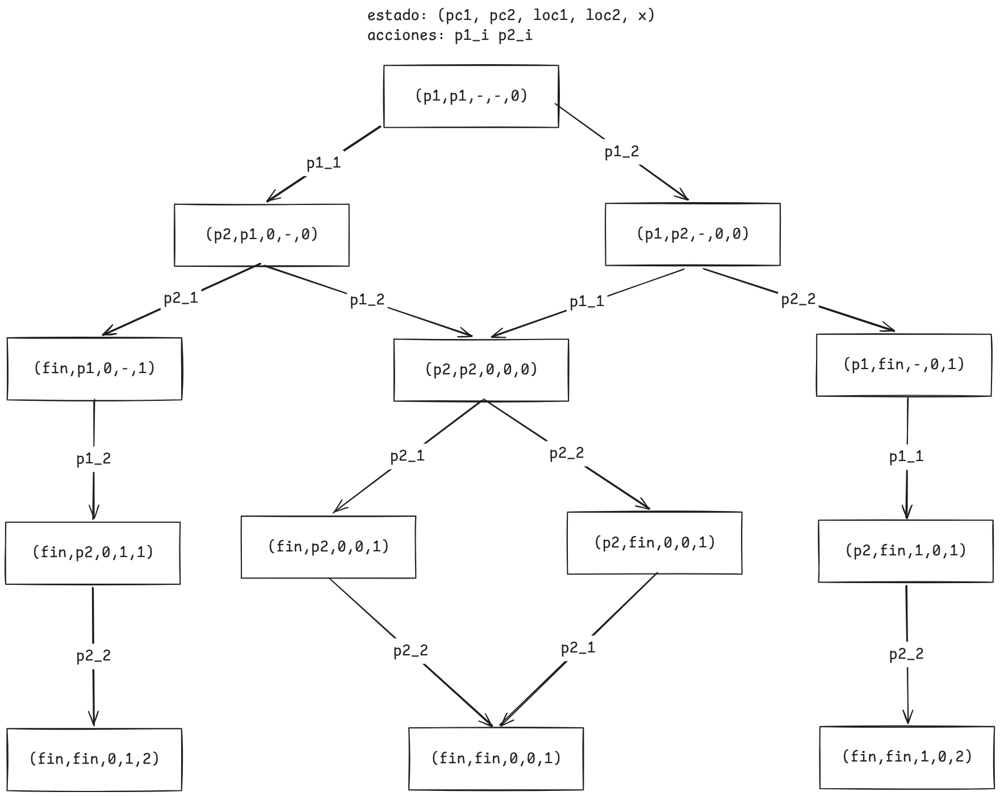
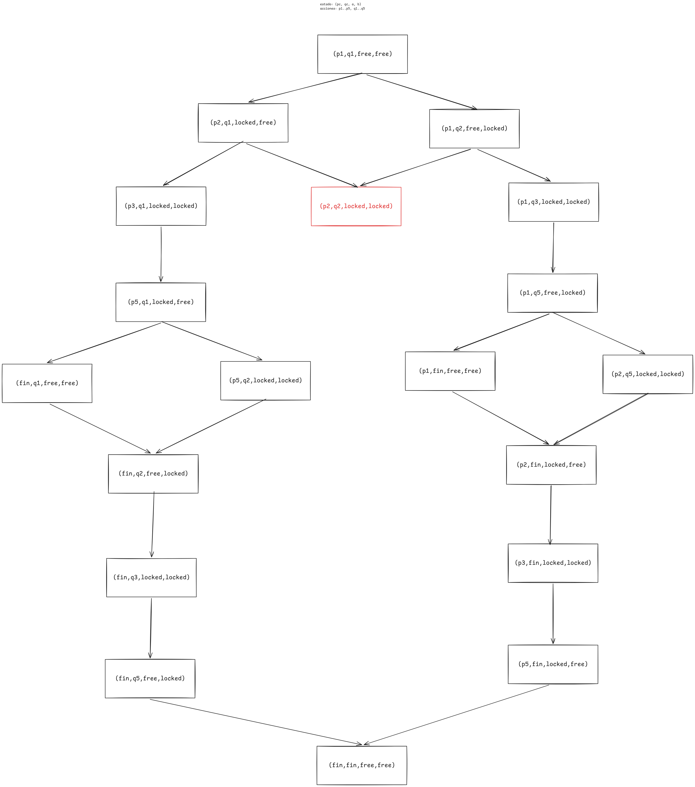
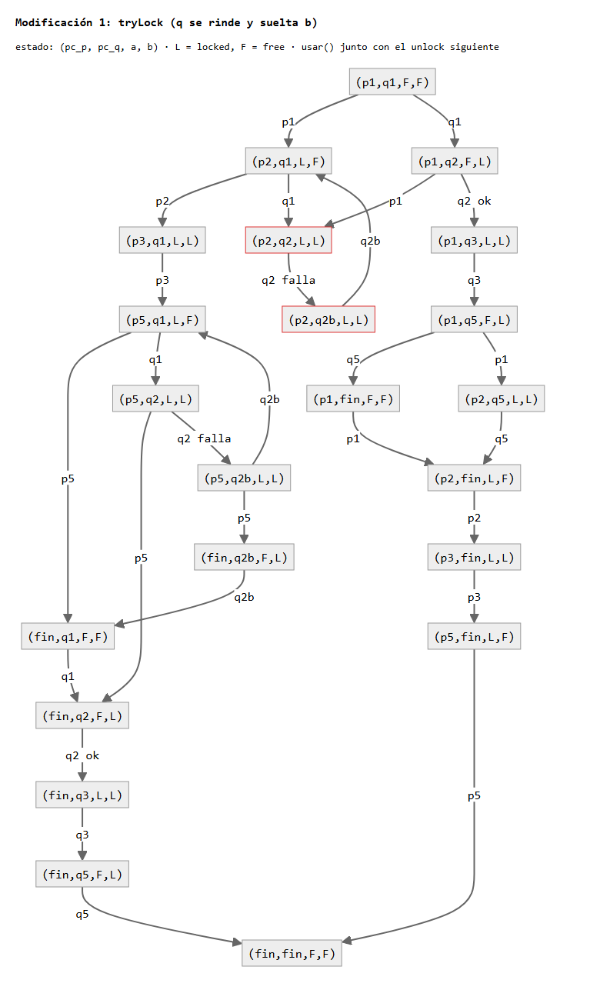
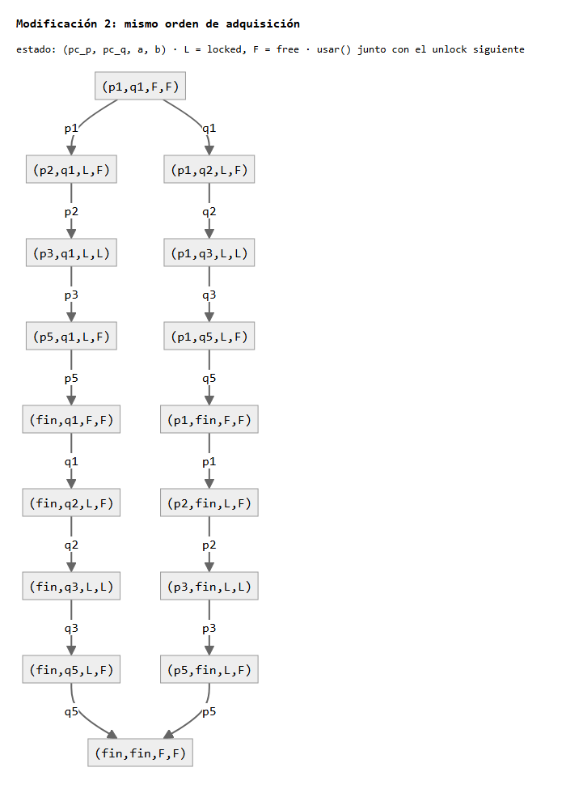
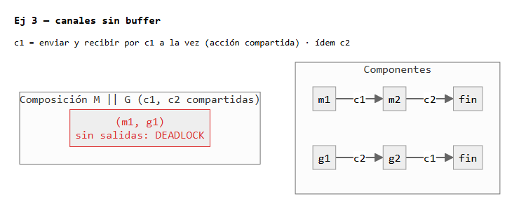
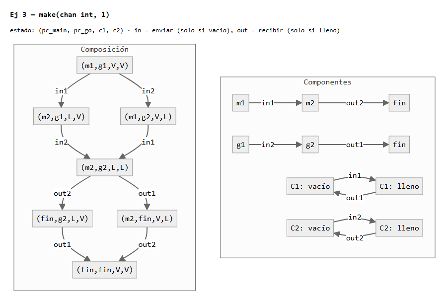
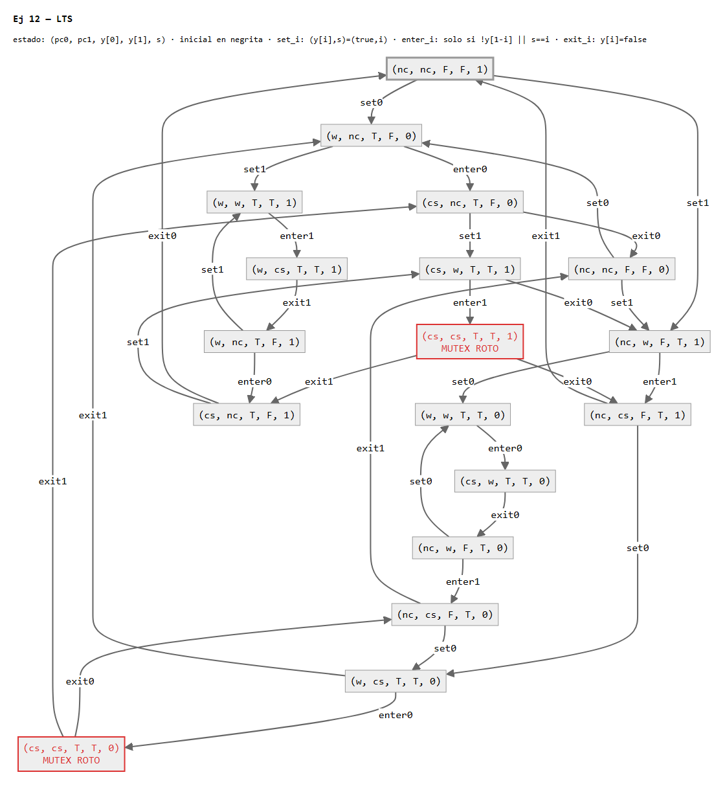

# Guía 7 — LTS y Lógica

## Ejercicio 1

```
LTS de incr() || incr()
estado: (pc1, pc2, loc1, loc2, x)

```


## Ejercicio 2

```
LTS de p() || q()
estado: (pc_p, pc_q, a, b)

simplificación: usar() se junta con el unlock siguiente (p3 -> p5, q3 -> q5)

camino más corto a deadlock: p1, q1 (o q1, p1) -> (p2, q2, locked, locked)
p tiene a y quiere b, q tiene b y quiere a
```


```
modificación 1 (resuelto por Claude): q se rinde y suelta b si a está tomado

void q() {
     while (true) {
q1:      b.lock()
q2:      if (a.tryLock()) break
q2b:     b.unlock()                 // rendirse y reintentar
     }
q3:  usar(); a.unlock()
q5:  b.unlock()
}

sin deadlock: todo estado salvo (fin,fin) tiene al menos una salida
(en (p2,q2,L,L) q ya no se bloquea: tryLock falla y sigue a q2b)
ojo: el lazo (p2,q1) -> (p2,q2) -> (p2,q2b) -> (p2,q1) puede repetirse para siempre (livelock), pero no es deadlock;
bajo fair choice p termina tomando b
```


```
modificación 2 (resuelto por Claude): q pide los locks en el mismo orden que p

void q() {
q1:  a.lock()
q2:  b.lock()
q3:  usar(); b.unlock()
q5:  a.unlock()
}

sin deadlock: todo estado salvo (fin,fin) tiene salida.
el que tiene a nunca espera a nadie (b solo lo pide quien ya tiene a), así que siempre puede avanzar
```


## Ejercicio 3 (resuelto por Claude)

```
main:  m1: c1 <- 1     m2: <-c2
go:    g1: c2 <- 2     g2: <-c1

sin buffer: enviar y recibir por un canal es UNA acción compartida (c1, c2)
(m1, g1): main quiere c1 pero go no está recibiendo c1; go quiere c2 pero main no está recibiendo c2
-> ningún thread avanza: deadlock en el estado inicial
```


```
con make(chan int, 1): cada canal es un LTS más (vacío/lleno)
in_i = enviar por ci (solo si vacío), out_i = recibir de ci (solo si lleno)
-> los dos envíos entran al buffer sin esperar, después los dos reciben: no se bloquea
```


## Ejercicio 4

```
                          □◇q   ◇□p   p U q   □(p → ◇q)   ○○q   □(p U q)
σ1 = {p}{p,q}{q}({p})ω     f     t      t         f        t       f
σ2 = ({p}{q})ω             t     f      t         t        f       t
σ3 = {q} ∅ ({p,q})ω        t     t      t         t        t       f
σ4 = {p} ∅ ({p,q}{p}∅)ω    t     f      f         t        t       f

σ1: período {p} sin q -> □◇q f, □(p→◇q) f, □(p U q) f (desde la 4 no llega q)
σ2: posición 3 = {p} -> ○○q f; p nunca se estabiliza -> ◇□p f
σ3: posición 2 = ∅: ahí p U q falla (no hay p mientras espera la q de la 3) -> □(p U q) f
σ4: ∅ en el período -> ◇□p f; posición 2 = ∅ -> p U q f y □(p U q) f
```

## Ejercicio 5

```
a) ◇(φ ∧ ψ) ≡ ◇φ ∧ ◇ψ  -> NO vale
   contraejemplo σ = {φ} {ψ} ∅ω: cumple ◇φ ∧ ◇ψ (φ en 1, ψ en 2), no cumple ◇(φ ∧ ψ) (nunca juntas)
   (sí vale ◇(φ ∧ ψ) → ◇φ ∧ ◇ψ)

b) □(φ ∧ ψ) ≡ □φ ∧ □ψ  -> vale
   □(φ ∧ ψ) en i ⇔ ∀ j ≥ i: φ y ψ en j ⇔ (∀ j ≥ i: φ en j) y (∀ j ≥ i: ψ en j) ⇔ □φ ∧ □ψ en i

c) ○◇φ ≡ ◇○φ  -> vale
   ○◇φ en i ⇔ ◇φ en i+1 ⇔ ∃ j ≥ i+1: φ en j
   ◇○φ en i ⇔ ∃ k ≥ i: ○φ en k ⇔ ∃ k ≥ i: φ en k+1 ⇔ (j = k+1) ∃ j ≥ i+1: φ en j

d) □◇φ → □◇ψ ≡ □(φ → ◇ψ)  -> NO vale
   contraejemplo σ = {φ} ∅ {ψ} {φ} ∅ω
   izq: □◇φ falso (φ finitas veces) -> la implicación es verdadera
   der: en la posición 4 vale φ y después nunca ψ -> □(φ → ◇ψ) falso
   (el lado izquierdo solo mira lo que pasa infinitas veces; una φ suelta no lo afecta)
```

```
e) □φ → ◇ψ ≡ φ U (ψ ∨ ¬φ)  -> vale  (resuelto por Claude)
   izq: □φ → ◇ψ ≡ ¬□φ ∨ ◇ψ ≡ ◇¬φ ∨ ◇ψ ≡ ◇(¬φ ∨ ψ) = ◇χ   con χ = ψ ∨ ¬φ
   der: φ U χ

   φ U χ ⇒ ◇χ: U exige que χ llegue
   ◇χ ⇒ φ U χ: sea k la PRIMERA posición ≥ i donde vale χ.
      en toda j con i ≤ j < k, χ es falso -> ¬φ es falso -> φ vale
      entonces φ vale hasta k y en k vale χ: es φ U χ
```

## Ejercicio 6


a) Satisfacible sí, por ejemplo traza a -> a -> a, valida no, por ejemplo b -> b -> a

b) Satisfacible sí, válida también. Es válida ya que el lado izquierda significa "a partir de la siguiente posición, o hay un a o lo habrá eventualmente", y si eso se cumple, en definitiva habrá un a eventualmente, o hay un a. La vuelta diría que no se cumple, porque a -> b -> b... cumple eventualmente a, pero no cumple el lado izquierdo.

c) Pongamos en palabras. Si siempre hay a, implica que a partir del siguiente NO sucederá que no haya A y siempre no haya a. A ojo la veo válida. Simplificando el lado derecho, te queda $\neg\bigcirc(\square\neg a)$. Es decir, no vale decir que a partir del siguiente, siempre NO hay a. es decir, a partir del siguiente, hay algun a _eventualmente_. es decir, nos queda un
$\square a \implies \bigcirc\lozenge  a$. Que es medio tautologico.

d) $(\square a)\ U\ (\lozenge b) \to \square(a\ U\ \lozenge b)$. Satisfacible sí, válida no.
Si el lado derecho de un U es $\lozenge\psi$, se simplifica: $X\ U\ \lozenge\psi \equiv \lozenge\psi$. Si $\lozenge\psi$ vale más adelante, ya vale desde ahora, así que la primera posición donde vale es la actual y X no se llega a mirar. Si no vale ahora, $\psi$ no llega nunca y el U falla.
Lado izquierdo: $(\square a)\ U\ (\lozenge b) \equiv \lozenge b$.
Lado derecho: $a\ U\ \lozenge b \equiv \lozenge b$, entonces $\square(a\ U\ \lozenge b) \equiv \square\lozenge b$.
Queda $\lozenge b \to \square\lozenge b$. No es válida: $\{b\}\,\emptyset^\omega$ cumple $\lozenge b$ pero no $\square\lozenge b$. Es satisfacible: $\{b\}^\omega$.

e) Satisfacible sí, definitvivamente, vease a -> b, pero no válida, ya que por ejemplo
vacio -> b es válido para $\lozenge b$ pero no para $(a \;\textbf{U} \; b)$


## Ejercicio 7


a) exclusión mutua:\
$\square\neg(critical_1 \;\wedge\; critical_2)$\
safety

b) permanencia finita:\
$\square(critical_i \implies \lozenge release_i)$\
liveness

c) ausencia de inanición:\
$\square(request_i \implies \lozenge critical_i)$\
liveness

d) acceso alternado:\
$\square(release_i \implies \bigcirc(\neg critical_i \;\textrm{W}\; release_j))$, con $i \neq j$\
safety

e)\
$\square\lozenge request_1 \implies \square\lozenge critical_1$\
liveness

f) (resuelto por Claude)\
$\lozenge\square request_1 \implies \square\lozenge critical_1$\
liveness

g) (resuelto por Claude)\
$\square\big((request_1 \wedge \neg critical_1) \implies (\neg critical_2 \;\textrm{W}\; (critical_1 \vee (critical_2 \;\textrm{W}\; (critical_1 \vee (\neg critical_2 \;\textrm{W}\; critical_1)))))\big)$\
safety\
esperar = pidió y todavía no entró. Tres fases mientras espera: 2 afuera, 2 adentro (una vez), 2 afuera; cualquiera se corta cuando entra 1. W y no U: no exige que 1 entre alguna vez (eso es el c), solo limita a 2 mientras espera.


## Ejercicio 8

N (en el próximo):\
$\varphi \;\textrm{N}\; \psi \equiv \neg\psi \;\textrm{W}\; (\psi \wedge \varphi)$\
hasta la próxima ψ no hay ψ, y cuando llega vale φ. W: si ψ no llega nunca, se cumple. (Si "la próxima" excluye la posición actual: $\bigcirc(\neg\psi \;\textrm{W}\; (\psi \wedge \varphi))$)

M (mientras) (resuelto por Claude):\
$\varphi \;\textrm{M}\; \psi \equiv \varphi \;\textrm{W}\; \neg\psi$\
antes del primer ¬ψ vale ψ, y ahí tiene que valer φ. W: si ψ vale siempre, φ también.

B (antes) (resuelto por Claude):\
$\varphi \;\textrm{B}\; \psi \equiv \neg\varphi \;\textrm{W}\; (\psi \wedge \neg\varphi)$\
φ no puede aparecer hasta que aparezca ψ (estrictamente antes). W: si φ no vale nunca, se cumple. (Si se permite que ψ y φ lleguen a la vez: $\neg\varphi \;\textrm{W}\; \psi$)

## Ejercicio 9 (resuelto por Claude)

$\square\big((\neg held \implies \lozenge held) \wedge (held \implies \lozenge\neg held)\big) \;\equiv\; \square\lozenge held \wedge \square\lozenge\neg held$\
el ○ se rompe porque un paso del otro thread no cambia held (stuttering). Con ◇ los pasos ajenos en el medio no importan.\
(equivalente con U: $\square\big((held \implies held \;\textrm{U}\; \neg held) \wedge (\neg held \implies \neg held \;\textrm{U}\; held)\big)$)

## Ejercicio 10

```
1) □(TRYING → ◇CRITICAL)           -> NO vale. contraejemplo: IDLE (TRYING BACKOFF)ω  (o (IDLE TRYING BACKOFF)ω)
2) □(TRYING → ◇(CRITICAL ∨ IDLE))  -> NO vale. contraejemplo: IDLE (TRYING BACKOFF)ω  (retry para siempre)
3) □(BACKOFF → □¬CRITICAL)         -> NO vale. contraejemplo: IDLE TRYING BACKOFF TRYING CRITICAL ...
4) □(BACKOFF → ◇TRYING)            -> vale: BACKOFF va a TRYING, o a IDLE que solo va a TRYING

conjuntos terminales: uno solo, {IDLE, TRYING, BACKOFF, CRITICAL} (todo el LTS: fuertemente conexo, sin salidas)

bajo fair choice:
1) y 2) pasan a valer: TRYING se visita infinitas veces -> acquire se toma infinitas veces
        (los lazos (TRYING BACKOFF)ω y (IDLE TRYING BACKOFF)ω son injustos)
3) sigue sin valer: es safety, el prefijo malo se continúa de forma justa
4) ya valía
```

## Ejercicio 11

```
observador:

LTL:
```

## Ejercicio 12

```
a) LTS (resuelto por Claude)
estado: (pc0, pc1, y[0], y[1], s)
nc = antes de asignar, w = en el await, cs = en critical
set_i:   nc -> w,  (y[i], s) = (true, i)
enter_i: w -> cs,  solo si !y[1-i] || s == i
exit_i:  cs -> nc, y[i] = false
simplificación: noncritical y critical no tocan estado compartido (se juntan con el paso siguiente)
```


b)\
$wait_i \equiv pc_i = w$ (pidió y está en el await)\
exclusión mutua: $\square\neg(critical_0 \;\wedge\; critical_1)$\
ausencia de inanición: $\square(wait_i \implies \lozenge critical_i)$, para $i = 0, 1$

c)\
Ambas fallan, se puede ver en el gráfico del LTS.

Exclusión mutua (safety): camino a un estado rojo\
(nc,nc,F,F,1) -> (w,nc,T,F,0) -> (cs,nc,T,F,0) -> (cs,w,T,T,1) -> (cs,cs,T,T,1)\
th1 entra porque s == 1 aunque th0 está adentro (gana el último que asignó s).\
No pasa a valer bajo fair choice: es safety, se rompe en un prefijo finito y ese prefijo se puede continuar de forma justa.

Ausencia de inanición (liveness): th0 pide y th1 le gana siempre\
(nc,nc,F,F,1) -> (w,nc,T,F,0) -> ((w,w,T,T,1) -> (w,cs,T,T,1) -> (w,nc,T,F,1))$^\omega$\
th0 está en w en todo el lazo: $wait_0$ vale siempre y $critical_0$ nunca.\
Bajo fair choice pasa a valer: en (w,nc,T,F,1) está habilitado enter0 (y[1] = F) y el lazo nunca lo toma -> es injusto.\
(todo el LTS es un único conjunto terminal y tiene estados con $critical_i$ -> toda ejecución justa entra infinitas veces)

## Ejercicio 13

```
a) LTS con y1 ≤ 2, y2 ≤ 2

```

```
b) ejecución infinita:

```

```
c)
exclusión mutua:
ausencia de deadlock:
ausencia de inanición:
```

## Ejercicio 14

```
a) sin buffer:

con buffer:

```

```
b)

```

```
c)

```
