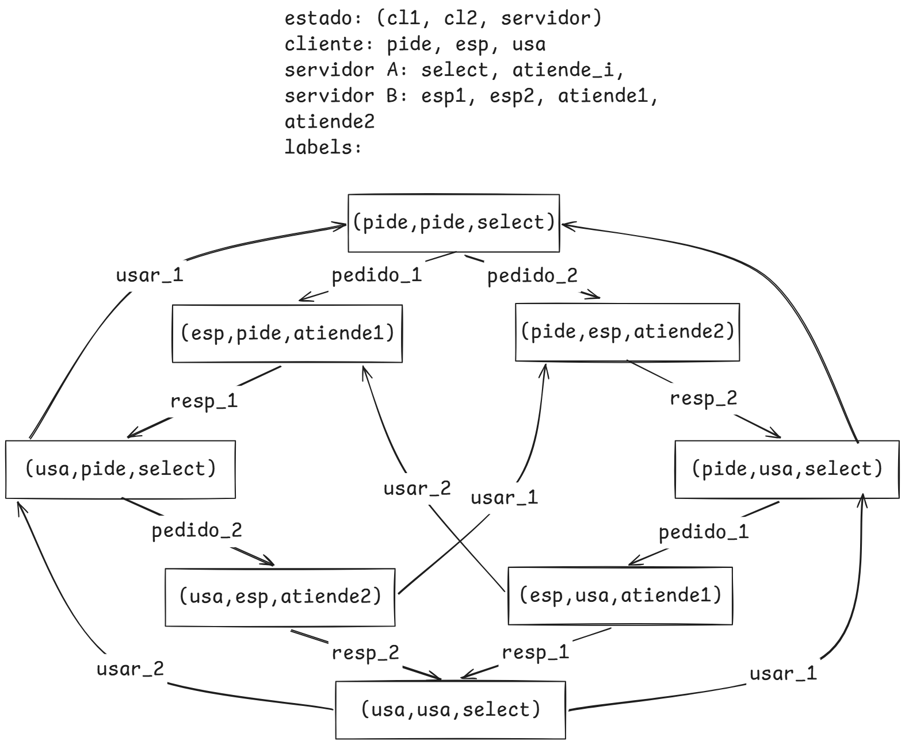
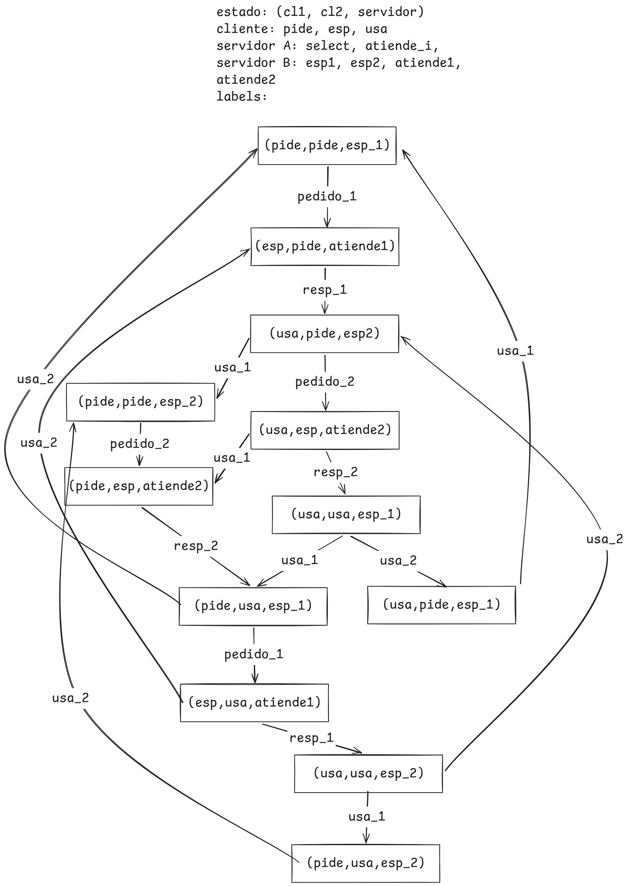

## Ejercicio 1

```hs
data Tipo = Urgente | Comun
type Llamada = Int
atender :: Llamada -> IO ()

data Centro = ...

nuevoCentro :: Int -> IO Centro
nuevoCentro k = ...

llamar :: Centro -> Tipo -> Llamada -> IO ()
llamar centro tipo llamada =

agenter :: Centro -> IO ()
agente centro = ...
```

## Ejercicio 2

Asumo now() como un timestamp actual en int.

```go
type RespuestaLugar struct {
    lugar int
}

type PedidoLugar struct {
    canal  chan RespuestaLugar 
}

type MensajePago struct {
    tipo  string ("cantidad", "pago")
    monto  int?
    canal  chan PagoRespuesta
    lugar  int
}

type PagoRespuesta struct {
    ok bool
    monto int?
}

func trapito(
    pedidos chan PedidoLugar,
    pedirLugares chan PedidoLugar
    avisosBarra chan int
) {
   (channel int) lugaresResp = create(chan int, 0)
   for {
        // cada trapito lee del canal mágico de trapitos, pedidos.
        pedido := receive(pedidos)
        send(pedirLugares, { canal: lugaresResp })
        lugarLibre := receive(lugaresResp)
        // hay lugar, entonces podemos avisar a quien corresponde. primero al barra, para que empiece la sesión.
        send(avisosBarra, lugarLibre)
        send(pedido.canal, lugarLibre)
    }
}

func precio(timestamp int) {
    int inicial = 1
    // 300000 ms = 5 minutos.
    return inicial + floor((now()-timestamp)/300000)
}

func lugares(
    cantLugares int
    pedirLugares chan PedidoLugar
    liberarLugares chan int
) {
    bool[] lugares = [false]*cantLugares //(ni idea la sintaxis)
    (chan PedidoLugar) pedir = pedirLugares;
    for {
        if (lugares.all(l => l)) pedir = nil
        else pedir = pedirLugares
        select {
            case p := receive(pedir): func {
                int lugarLibre = lugares.findIndex(l => !l)
                send(p.canal, lugarLibre)
                lugares[lugarLibre] = true
            }
            case l := receive(liberarLugares): func {
                lugares[l] = false
            }
        }
    }
}

func barra(
    avisoLugares chan int
    quierePagar chan MensajePago
    liberarLugares chan int
) {
    map[int]int reservas = {}

    for {
        select {
            case r := receive(avisoLugares): func {
                reservas[r] = now();
            }
            case m := receive(quierePagar): func {
                if m.tipo == "cantidad" {
                    send(m.canal, { ok: true, monto: precio(reservas[m.lugar]) })
                } else {
                    montoReal := precio(reservas[m.lugar])
                    if (montoReal >= m.monto) {
                        send(m.canal, { ok:true })
                        send(liberarLugares, m.lugar)
                    }
                    else send(m.canal, { ok:false, monto: montoReal })
                }
            }
        }
    }
}

func hincha(
    pedidos chan PedidoLugar
    quierePagar chan MensajePago
) {
    (chan RespuestaLugar) respuestaLugar = create(chan RespuestaLugar, 0)

    send(pedidos, { canal: respuestaLugar })
    lugarLibre := receive(respuestaLugar)
    //estaciona
    verPartido()

    (chan RespuestaPago) respuestaPago = create(chan RespuestaPago, 0)
    send(quierePagar, { tipo: "cantidad", canal: respuestaPago, lugar: lugarLibre })
    m := receive(respuestaPago)
    
    resp := { ok: false, monto: m.monto }
    // Hasta no pagar bien, no termina
    for (!resp.ok) {
        send(quierePagar, { tipo: "pago", canal: respuestaPago, lugar: lugarLibre, monto: resp.monto })
        resp = receive(respuestaPago)
    }
}

func main() {
    (chan PedidoLugar) pedidos        = create(chan PedidoLugar, 0)   // hinchas -> trapitos
    (chan PedidoLugar) pedirLugares   = create(chan PedidoLugar, 0)   // trapitos -> lugares
    (chan int)         liberarLugares = create(chan int, 0)           // barra -> lugares
    (chan int)         avisosBarra    = create(chan int, 0)           // trapitos -> barra
    (chan MensajePago) quierePagar    = create(chan MensajePago, 0)   // hinchas -> barra

    process lugares(N, pedirLugares, liberarLugares)
    process barra(avisosBarra, quierePagar, liberarLugares)
    for i := 0; i < T; i++ { process trapito(pedidos, pedirLugares, avisosBarra) }
    for i := 0; i < H; i++ { process hincha(pedidos, quierePagar) }
}
```

### Ausencia de deadlock (resuelto por Claude)

quién le habla a quién (las respuestas vuelven por canales propios de cada cliente):

```
hincha --pedidos--> trapito --pedirLugares--> lugares
   |                  |                         ^
   |              avisosBarra                   | liberarLugares
   |                  v                         |
   +---quierePagar--> barra --------------------+
```

no hay ciclos de sends: todo pedido va hacia un servidor (lugares, barra) y la respuesta
vuelve a alguien que está bloqueado en receive de su canal propio esperándola.

1. lugares y barra siempre vuelven al select:
   entre dos receives solo hacen sends de respuesta a un cliente que acaba de pedir y
   está esperando en receive -> se completan.
   send(liberarLugares) de la barra se completa: en lugares el case de liberar está
   siempre abierto (nunca es nil).

2. trapito, puntos de bloqueo:
   receive(pedidos)          espera hinchas; si no vienen más es un servicio esperando
                             pedidos, que no es deadlock (hoja útil)
   send(pedirLugares)        bloquea solo si no hay lugar libre (guarda nil); se destraba
                             cuando se libera un lugar (punto 4)
   receive(lugaresResp)      lugares contesta todo pedido que acepta
   send(avisosBarra)         la barra vuelve siempre al select (punto 1)
   send(pedido.canal)        el hincha está bloqueado en receive(respuestaLugar)
   orden: avisa primero a la barra -> la reserva existe antes de que el hincha pueda pagar

3. hincha:
   send(pedidos)             algún trapito vuelve a receive(pedidos): solo se trabarían
                             esperando lugar, y eso se resuelve (punto 4)
   consulta y pagos          la barra siempre recibe y contesta (punto 1)
   loop de pago termina      si falla, la barra devuelve el monto actual y reintenta con
                             ese; solo vuelve a fallar si justo pasaron otros 5 minutos

4. los lugares vuelven:
   todo hincha con lugar ve el partido (termina) y paga hasta que le aceptan (punto 3);
   al aceptar un pago la barra libera el lugar -> si estaban los N ocupados, alguno se
   libera y la guarda de pedirLugares se reabre.

=> toda operación bloqueante es destrabada eventualmente por otro proceso: no hay deadlock.
   si H > N, los hinchas que sobran esperan su lugar, pero esperan algo que llega.

## Ejercicio 3

### a) LTS

```
componentes (pedido_i y resp_i: acciones compartidas, sin buffer -> cliente y servidor
avanzan juntos en un solo paso; usar_i: acción local)

cliente i:   pide --pedido_i--> esp --resp_i--> usa --usar_i--> pide
servidor A:  select --pedido_i--> atiende_i --resp_i--> select        (i = 1, 2)
servidor B:  esp_1 --pedido_1--> atiende1 --resp_1--> esp_2 --pedido_2--> atiende2 --resp_2--> esp_1

sistema: cl1 ‖ cl2 ‖ servidor, estado = (cl1, cl2, servidor)
una acción compartida avanza solo si los dos que participan la tienen habilitada
(ej: en B con servidor en esp_1, el cliente 2 no puede hacer pedido_2)

proposiciones:
pide_i    : cl_i = pide          (línea 2, incluso bloqueado en el send)
espera_i  : cl_i = esp           (línea 3)
usa_i     : cl_i = usa           (línea 4)
atiende_i : servidor = atiende_i (recibió pedido_i, todavía no mandó resp_i)
en las flechas, usa_i = acción usar_i
```

Versión A (8 estados, 16 transiciones):



Versión B (12 estados; en esp_1 / esp_2 el servidor solo escucha a un cliente):



### b) LTL

1. $\square(pide_i \implies \lozenge usa_i)$
2. $\square(espera_i \implies \neg pide_i \;\textrm{W}\;usa_i)$
3. $\square(atiende_1 \implies atiende_1 \;\textrm{W}\; (\neg atiende_1 \;\textrm{W}\; atiende_2 ))$

2 y 3 con W: son safety (se rompen en un prefijo finito), no obligan a que llegue usa_i / atiende_2.

### c)

```
1. □◇usa_2
A: NO. traza ((pide,pide,select) (esp,pide,at1) (usa,pide,select))^ω  -> nunca usa_2.
   bajo fair choice SÍ vale: el lazo pasa ∞ veces por (pide,pide,select) y (usa,pide,select),
   que tienen habilitada pedido_2, y nunca la toma -> lazo injusto.
B: SÍ. cada cliente hace a lo sumo un usar seguido sin el servidor (después necesita pedido),
   y no hay estados sin salida -> toda traza infinita hace ∞ pasos del servidor; el servidor es
   un ciclo fijo que pasa por resp_2 -> usa_2 vale ∞ veces.

2. □(pide_1 → ◇espera_1)
A: NO. traza ((pide,pide,select) (pide,esp,at2) (pide,usa,select))^ω  -> pide_1 siempre, nunca espera_1.
   bajo fair choice SÍ vale: el lazo nunca toma pedido_1, habilitada en (pide,pide,select) y
   (pide,usa,select) -> lazo injusto.
B: SÍ. el servidor llega a esp_1 (ciclo fijo, igual que en 1); ahí, con cl1 en pide, lo único
   además de pedido_1 es un usar_2 (finito) -> pedido_1 ocurre y cl1 pasa a espera.

3. □¬(usa_1 ∧ usa_2)
NO en ambas (safety: fair choice no la salva, el estado malo se alcanza en un prefijo finito):
A: (pide,pide,select) -> (esp,pide,at1) -> (usa,pide,select) -> (usa,esp,at2) -> (usa,usa,select)
B: (pide,pide,esp_1) -> (esp,pide,atiende1) -> (usa,pide,esp_2) -> (usa,esp,atiende2) -> (usa,usa,esp_1)

4. □(espera_1 → ○(espera_1 ∨ usa_1))
SÍ en ambas. desde un estado con espera_1, toda transición es resp_1 (-> usa_1) o un paso de
otro proceso (cl1 sigue en esp: espera_1); y no hay estados sin salida, así que siempre hay
siguiente. acá ○ no se rompe con pasos ajenos porque esos pasos dejan espera_1 igual.
```

## Ejercicio 4

Consigna (copiada del enunciado). Respuesta: `maxSubArray(A, 0, len(A)-1)` / `mejoresCasos(A, 0, len(A)-1).optimo`.
`mejorSumaLineal(A, desde, hasta)` es secuencial, Θ(|desde − hasta|): mejor segmento que arranca en `desde` y avanza hacia `hasta`.

```java
// Variante (I)
int maxSubArray(int[] A, int lo, int hi) {
    if (hi - lo == 1) {
        return A[lo];
    }
    int mid = (lo + hi) / 2;
    int low = maxSubArray(A, lo, mid);
    int high = maxSubArray(A, mid, hi);
    int cruza = mejorSumaLineal(A, mid-1, lo-1)   // mejor sufijo de la parte baja
              + mejorSumaLineal(A, mid, hi-1);    // mejor prefijo de la parte alta
    return max(low, high, cruza);
}
```

```java
// Variante (II)
Tupla mejoresCasos(int[] A, int lo, int hi) {
    // Tupla(total, optimo, prefijo, sufijo)
    if (hi - lo == 1) {
        return new Tupla(A[lo], A[lo], A[lo], A[lo]);
    }
    int mid = (lo + hi) / 2;
    Tupla b = mejoresCasos(A, lo, mid);
    Tupla d = mejoresCasos(A, mid, hi);
    int total   = b.total + d.total;
    int optimo  = max(b.optimo, d.optimo, b.sufijo + d.prefijo);
    int prefijo = max(b.prefijo, b.total + d.prefijo);
    int sufijo  = max(d.sufijo, d.total + b.sufijo);
    return new Tupla(total, optimo, prefijo, sufijo);
}
```

a) fork-join

```java
// Variante (I)
class MaxSubArray extends RecursiveTask<int> {
    int[] A, int lo, int hi;
    MaxSubArray(A, lo, hi){this.A=A; this.lo=lo; this.hi=hi;}

    int compute() {
        if (hi - lo == 1) {
            return A[lo];
        }
        int mid = (lo + hi) / 2;
        MaxSubArray low = new MaxSubArray(A, lo, mid);
        low.fork();
        MaxSubArray high = new MaxSubArray(A, mid, hi);
        int cruza = mejorSumaLineal(A, mid-1, lo-1)   // mejor sufijo de la parte baja
                + mejorSumaLineal(A, mid, hi-1);    // mejor prefijo de la parte alta
        return max(high.compute(), low.join(), cruza);
    }
}
```

```java
// Variante (II)
class MejoresCasos extends RecursiveTask<Tupla> {
    int[] A; int lo, hi;
    MejoresCasos(int[] A, int lo, int hi) { this.A = A; this.lo = lo; this.hi = hi; }

    Tupla compute() {
        if (hi - lo == 1) {
            return new Tupla(A[lo], A[lo], A[lo], A[lo]);
        }
        int mid = (lo + hi) / 2;
        MejoresCasos izq = new MejoresCasos(A, lo, mid);
        izq.fork();                                          // b en paralelo
        Tupla d = new MejoresCasos(A, mid, hi).compute();    // d en este thread
        Tupla b = izq.join();                                // join recién después del compute
        // combinar: 3 sumas y 4 max de tamaño fijo, no depende de n -> Θ(1)
        int total   = b.total + d.total;
        int optimo  = max(b.optimo, d.optimo, b.sufijo + d.prefijo);
        int prefijo = max(b.prefijo, b.total + d.prefijo);
        int sufijo  = max(d.sufijo, d.total + b.sufijo);
        return new Tupla(total, optimo, prefijo, sufijo);
    }
}
// llamada inicial: new MejoresCasos(A, 0, len(A)).compute().optimo   (hi exclusivo)
```

b) work / span / paralelismo

```
las dos mitades son independientes (solo leen A, cada una su rango, no escriben nada
compartido) -> corren en paralelo: en el work se suman, en el span cuenta una sola copia.
el combinar necesita b y d -> va después del join, entra entero al camino crítico.

Variante (I)    combinar = cruza: dos mejorSumaLineal secuenciales de n/2 c/u -> Θ(n)
work:
W(1) = Θ(1)
W(n) = 2·W(n/2) + Θ(n)
a = 2, b = 2, n^(log_b a) = n;  f(n) = Θ(n) = Θ(n^(log_b a))  ->  caso 2  ->  W(n) = Θ(n log n)
span:
S(1) = Θ(1)
S(n) = S(n/2) + Θ(n)        la cruza es secuencial: suma entera en cada nivel
a = 1, b = 2, n^(log_b a) = 1;  f(n) = Θ(n) = Ω(n^(0+ε)) con ε = 1;
regularidad: f(n/2) = n/2 ≤ c·n con c = 1/2  ->  caso 3  ->  S(n) = Θ(n)
paralelismo:
W(n) / S(n) = Θ(n log n) / Θ(n) = Θ(log n)      cuello de botella: la cruza lineal de la raíz

Variante (II)   combinar = 3 sumas + 4 max de tamaño fijo -> Θ(1)
work:
W(1) = Θ(1)
W(n) = 2·W(n/2) + Θ(1)
a = 2, b = 2, n^(log_b a) = n;  f(n) = Θ(1) = O(n^(1-ε)) con ε = 1  ->  caso 1  ->  W(n) = Θ(n)
span:
S(1) = Θ(1)
S(n) = S(n/2) + Θ(1)
a = 1, b = 2, n^(log_b a) = 1;  f(n) = Θ(1) = Θ(n^(log_b a))  ->  caso 2  ->  S(n) = Θ(log n)
paralelismo:
W(n) / S(n) = Θ(n / log n)
```

c) conclusión (n = 2^10, P = 64, T_P ≈ T1/P + T∞)

Es evidente asumir que la versión más conveniente para una computadora con alta capacidad de paralelismo sería la versión 2, que igualmente es más rápida sin paralelizar. Veamoslo con cuentas. Con una entrada de tamaño 2^10, el $T_1$ de cada versión ya denota la superioridad de la versión 2, dado que $T_1^I$ es $10 \cdot 2^{10}$ mientras que $T_1^{II}$ sería 10 veces menos. Ahora, apliquemos a una computadora con 64 procesadores, usando la cota de arriba.

Versión 1:
$T_P \approx \frac{10\cdot2^{10}}{64} + 2^{10}$. El número daría 1184.

Versión 2:
$T_P \approx \frac{2^{10}}{64} + 10$ que daría solamente 26.

Es decir, la versión 1 paso de 10240 pasos a 1184, mientras que la segunda paso de 1024 a 26. No solo a nivel absoluto es muchisimo más conveniente la segunda versión sino que el speedup es magnitudes más grande en la segunda versión, con una mejora de casi x40 contra un x8.6 de la primera versión. 

Conclusión (agregado por Claude): lo que decide en una máquina con mucho paralelismo es el paralelismo W/S del ítem b, que acota el speedup alcanzable con cualquier P.

```
Variante (I):  paralelismo Θ(log n) = 10 -> speedup ≤ ~10 con cualquier cantidad de procesadores.
               en T_64 domina el span: 1024 (cruza lineal de la raíz) contra 160 de work repartido;
               agregar procesadores no la ayuda.
Variante (II): paralelismo n / log n = 1024/10 ≈ 102 > 64 -> con 64 procesadores el speedup es casi
               lineal (~39 de un máximo de 64), y seguiría escalando hasta ~100 procesadores.
=> conviene la (II): menos work y, sobre todo, span logarítmico.
```
