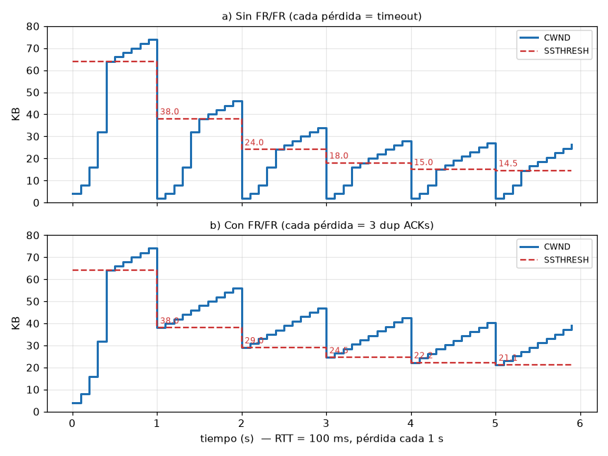

## Ejercicio 1

### a)
No, no se puede realizar prealocación de buffers en datagrams porque no hay donde prealocar, no hay circuito definido

### b)
Sssa, puede repartir equitativamente, pero no puede reducir la congestión. Si nos pasamos del threshold, por más repartido que esté, no nos sirve. Ayuda, pero no alcanza.
Cuando se sube a los thresholds, hay que bajar las tasas de envío necesariamente.

### c)
No. Con buffers infinitos no se pierden paquetes, pero el problema pasa de la pérdida al **delay**: si la demanda supera la capacidad ($\rho = \lambda/\mu \ge 1$), la cola crece sin límite y $E[T] \to \infty$.

- Los paquetes tardan tanto en salir que al emisor le vence el **timeout** y **retransmite**, aunque el original siga en la cola.
- Esas retransmisiones son duplicados que también se encolan → más carga → más delay → más timeouts. Se realimenta.
- Cuando el original finalmente llega, ya fue retransmitido: la red trabaja a full transportando copias inútiles, y el **goodput tiende a 0** (colapso de congestión).

Más memoria solo posterga el problema; lo que hace falta es que las fuentes bajen la tasa (Nagle, "On packet switches with infinite storage", 1987).

## Ejercicio 2

### a)
No hace falta control de congestión cuando no hay recursos compartidos que se puedan saturar:

- **Enlace dedicado** punto a punto (sin otros flujos ni routers intermedios compartidos): alcanza con control de flujo.
- **Recursos reservados**: conmutación de circuitos o QoS con reserva de ancho de banda y buffers (lazo abierto).
- **Red sobredimensionada** respecto de la demanda máxima, o un flujo siempre limitado por la RWND (o por la aplicación) a una tasa menor que la capacidad del camino.

### b)
1. **Pérdidas por errores de bit (enlaces inalámbricos).** TCP interpreta toda pérdida como congestión y achica la CWND aunque la red esté vacía → throughput innecesariamente bajo.
   *Medidas:* retransmisión a nivel enlace (ARQ de 802.11) para que TCP no vea la pérdida; feedback explícito (ECN) para distinguir congestión de errores.
2. **Conexión idle.** Después de un rato sin transmitir, la CWND refleja el estado de la red de hace mucho; mandar una ventana grande de golpe puede congestionar.
   *Medida:* reiniciar la ventana tras 1 RTO idle: $RW = \min(IW, CWND)$.
3. **Emisor limitado por la aplicación (o por RWND).** Si FlightSize < CWND, la CWND nunca se "probó" contra la red: puede haber crecido sin que la red aguante ese volumen.
   *Medida:* no crecer la CWND si no se está usando, y calcular SSTHRESH con **FlightSize/2** (no CWND/2), que es lo que de verdad estaba en la red.

## Ejercicio 3

### a)
Al comienzo no se sabe nada de la red:

- $CWND = IW = 2 \cdot SMSS = 4\text{KB}$ (chica, para no inundar).
- $SSTHRESH = ISSTHRESH = 64\text{KB}$ (alto, "arbitrariamente grande", para que la conexión arranque en Slow Start hasta encontrar el límite por pérdida o por RWND).

### b)
Ante un time-out:

- $SSTHRESH = \max(FlightSize/2,\ 2 \cdot SMSS)$
- $CWND = LW = 1 \cdot SMSS$, se retransmite el segmento perdido y se vuelve a **Slow Start** (además el RTO se duplica — Karn).

El timeout es la señal más grave (no volvió ni un ACK), por eso se vuelve a empezar de abajo.

### c)
Porque no se conoce la capacidad del camino. Una ráfaga grande de entrada puede desbordar el buffer del cuello de botella: se pierde gran parte (o toda) la ráfaga → timeout → retransmisiones, y además se perjudica a los otros flujos que comparten ese router. Es lo que hacía TCP originalmente (mandaba toda la AdvertisedWindow) y llevó a los colapsos de congestión de 1986.

Slow Start "tantea": duplica por RTT, así que llega a una ventana de $W$ en solo $\log_2(W/IW)$ RTTs, sin el riesgo de arrancar ciego.

### d)
**1 SMSS por RTT.** Por cada ACK se suma $SMSS \cdot SMSS / CWND$; en un RTT llegan $\approx CWND/SMSS$ ACKs, así que en total:

$$\frac{CWND}{SMSS} \cdot \frac{SMSS^2}{CWND} = SMSS$$

## Ejercicio 4

Los 4 segmentos entran en la IW (750 B < 4 KB), así que salen todos juntos y en orden. Numerando desde el byte 1:

| Segmento | Tamaño | Bytes |
|---|---|---|
| 1 | 100 | 1–100 |
| 2 | 150 | 101–250 |
| 3 | 200 | 251–450 |
| 4 | 300 | 451–750 |

Llegan en el orden 1, 3, 4, 2.

### a)
El ACK es acumulativo: indica el próximo byte que el receptor espera.

| Llega | Bytes | ACK | |
|---|---|---|---|
| 1 | 1–100 | 101 | normal |
| 3 | 251–450 | 101 | duplicado #1 (falta 101–250) |
| 4 | 451–750 | 101 | duplicado #2 |
| 2 | 101–250 | 751 | llena el hueco, el ACK salta al final |

### b)
**SSTHRESH = 64 KB** (no cambia). Solo se modifica ante un timeout o 3 ACKs duplicados; acá hubo 2 duplicados y ningún timeout, así que no se dispara FR/FR ni hay pérdida.

### c)
Como $CWND = 4\text{KB} < SSTHRESH = 64\text{KB}$, estamos en Slow Start: $CWND \mathrel{+}= \min(N, SMSS)$ por ACK, con N = bytes nuevos reconocidos (tomando 1 KB = 1024 B, SMSS = 2048 B).

| ACK | N | min(N, SMSS) | CWND |
|---|---|---|---|
| inicio | — | — | 4096 |
| 101 | 100 | 100 | 4196 |
| 101 (dup) | 0 | 0 | 4196 |
| 101 (dup) | 0 | 0 | 4196 |
| 751 | 650 | 650 | 4846 |

**CWND = 4096 + 750 = 4846 B** (≈ 4,73 KB). Los duplicados no suman porque no reconocen bytes nuevos.

## Ejercicio 5

$RTT_{i+1} = \alpha \cdot RTT_i + (1-\alpha)\cdot SampleRTT$, $\ RTO = 2 \cdot RTT$. Se toma el RTT inicial como la primera medición (80 ms), así que tras el ACK 1: RTT = 80, RTO = 160. Valores en ms.

### a) $\alpha = 1$

| ACK | Sample | RTT est. | RTO |
|---|---|---|---|
| 1 | 80 | 80 | 160 |
| 2 | 20 | 80 | 160 |
| 3 | 100 | 80 | 160 |
| 4 | 90 | 80 | 160 |

Con $\alpha = 1$ las muestras nuevas no pesan nada: el estimado queda fijo en la primera medición.

### b) Otros $\alpha$

**$\alpha = 0{,}8$**

| ACK | Sample | RTT est. | RTO |
|---|---|---|---|
| 1 | 80 | 80 | 160 |
| 2 | 20 | 68 | 136 |
| 3 | 100 | 74,4 | 148,8 |
| 4 | 90 | 77,52 | 155,04 |

**$\alpha = 0{,}6$**

| ACK | Sample | RTT est. | RTO |
|---|---|---|---|
| 1 | 80 | 80 | 160 |
| 2 | 20 | 56 | 112 |
| 3 | 100 | 73,6 | 147,2 |
| 4 | 90 | 80,16 | 160,32 |

**$\alpha = 0{,}4$**

| ACK | Sample | RTT est. | RTO |
|---|---|---|---|
| 1 | 80 | 80 | 160 |
| 2 | 20 | 44 | 88 |
| 3 | 100 | 77,6 | 155,2 |
| 4 | 90 | 85,04 | 170,08 |

**$\alpha = 0{,}2$**

| ACK | Sample | RTT est. | RTO |
|---|---|---|---|
| 1 | 80 | 80 | 160 |
| 2 | 20 | 32 | 64 |
| 3 | 100 | 86,4 | 172,8 |
| 4 | 90 | 89,28 | 178,56 |

Cuanto más chico $\alpha$, más sigue el estimado a la última muestra: después del 20 ms el RTO se desploma (160 → 64 con $\alpha = 0{,}2$), y con $\alpha$ alto casi no se mueve.

### c) ¿Time-out?
Hay time-out si una muestra supera al RTO vigente antes de actualizar:

| $\alpha$ | RTO tras ACK 2 | Sample ACK 3 | ¿Time-out? |
|---|---|---|---|
| 1,0 | 160 | 100 | no |
| 0,8 | 136 | 100 | no |
| 0,6 | 112 | 100 | no |
| 0,4 | 88 | 100 | **sí** |
| 0,2 | 64 | 100 | **sí** |

El ACK 4 (90 ms) no da time-out en ningún caso (todos los RTO tras el ACK 3 son > 147).

Con $\alpha$ bajo el estimador le cree demasiado a una sola muestra atípica (el 20 ms): el RTO baja tanto que el ACK 3, con un RTT normal, llega tarde. Es un **time-out espurio**: el segmento no se perdió, pero el emisor retransmite un duplicado y achica la CWND sin que haya congestión. Por eso se usa $\alpha$ alto (0,8–0,9).

## Ejercicio 6

Con una IW = 4KB, llegar a 24KB en CWND tomar 3 RTTs (30 msegs) dado  que, asumiendo que todos los acks llegan ok y dentro del RTO, sin acks duplicados, el CWND pasa de 4KB a 8KB, a 16KB a 32KB > 24KB, entonces los paquetes a esa conexión mandan 24KB, en 3 RTTs.

## Ejercicio 7

### a)
Con la fórmula vieja ($CWND \mathrel{+}= SMSS$ por ACK), el crecimiento depende de la **cantidad de ACKs**, no de cuántos datos reconocen. Un receptor (malicioso o no) puede partir el reconocimiento de un segmento en muchos ACKs chiquitos (**ACK division**): cada uno suma un SMSS entero, y el emisor infla la CWND muchísimo más rápido de lo que la red justifica → agresivo, inequitativo con otros flujos y causa congestión.

Con $\min(N, SMSS)$ el crecimiento queda atado a los **bytes efectivamente reconocidos** (N): partir los ACKs ya no da ventaja.

### b)
- **Slow Start más lento:** la CWND crece por ACK. Con 1 ACK cada 2 segmentos llegan la mitad de ACKs, y cada uno suma como mucho 1 SMSS (aunque reconozca 2) → la ventana crece ~×1.5 por RTT en vez de ×2. Lo mismo en Congestion Avoidance (crece más lento).
- **RTT medido más grande:** la demora (hasta 500ms) se suma a las muestras → RTT estimado y RTO inflados → se reacciona más tarde a pérdidas reales.
- **Ráfagas:** cada ACK libera 2 segmentos de golpe en vez de uno → el "ACK clock" es menos suave.
- **Esperas:** si el emisor tiene un solo segmento pendiente (p. ej. al final de un archivo o con ventana impar), el ACK puede tardar los 500ms completos.

(Por eso el RFC pide que los segmentos fuera de orden se ACKeen **inmediatamente**: así no se demoran los ACKs duplicados que disparan Fast Retransmit.)

## Ejercicio 8

**Supuestos** (el enunciado no los da): RTT = 100 ms (10 RTTs por segundo), IW = 4 KB, SSTHRESH inicial = 64 KB, SMSS = 2 KB, RWND grande (no limita), en cada pérdida se pierde un solo segmento y FlightSize = CWND (se usa toda la ventana). La pérdida se detecta justo en t = 1, 2, 3… s (ignoro el tiempo de espera del RTO y el inflado transitorio de FR/FR).

En cada pérdida, en ambos casos: $SSTHRESH = \max(FlightSize/2,\ 2\,SMSS)$. Lo que cambia es la CWND.

### a) Sin FR/FR
Cada pérdida se detecta por **time-out** → $CWND = 1\,SMSS = 2$ KB y Slow Start hasta el nuevo SSTHRESH, después CA.

| Segundo | CWND por RTT (KB) | Pierde con | SSTHRESH nuevo |
|---|---|---|---|
| 0–1 | 4, 8, 16, 32, 64, 66, 68, 70, 72, 74 | 76 | 38 |
| 1–2 | 2, 4, 8, 16, 32, 38, 40, 42, 44, 46 | 48 | 24 |
| 2–3 | 2, 4, 8, 16, 24, 26, …, 34 | 36 | 18 |
| 3–4 | 2, 4, 8, 16, 18, …, 28 | 30 | 15 |
| 4–5 | 2, 4, 8, 15, 17, …, 27 | 29 | 14,5 |

SSTHRESH converge a **14 KB**: cada segundo son 3 RTTs de Slow Start (2→4→8→14) y 6 de CA (hasta 26), y se pierde con 28 → 28/2 = 14. Gráfico: dientes que caen a casi 0 y suben en rampa exponencial + lineal.

### b) Con FR/FR
Cada pérdida se detecta por **3 ACKs duplicados** → $CWND = SSTHRESH$ (tras la recuperación) y se sigue en **CA**, sin volver a Slow Start.

| Segundo | CWND por RTT (KB) | Pierde con | SSTHRESH nuevo |
|---|---|---|---|
| 0–1 | 4, 8, 16, 32, 64, 66, …, 74 | 76 | 38 |
| 1–2 | 38, 40, …, 56 | 58 | 29 |
| 2–3 | 29, 31, …, 47 | 49 | 24,5 |
| 3–4 | 24,5, …, 42,5 | 44,5 | 22,25 |

Converge a SSTHRESH = **20 KB**: arranca en S, suma 9 veces 2 KB y pierde con S + 20 → $S = (S+20)/2 \Rightarrow S = 20$. Gráfico: **diente de sierra** entre 20 y 38 KB (AIMD puro).

**Conclusión:** con FR/FR la ventana nunca vuelve a 1 SMSS, así que en promedio es mucho mayor (~29 KB contra ~15 KB) → más throughput con la misma tasa de pérdida.

## Ejercicio 9

Para todo caso, asumimos SSTHRESH inicial 64KB, CWND inicial = IW = 2*SMSS  = 4KB, SMSS = 2KB, RWND = 64KB

Además: una ráfaga de **X KB o más** (X = 32 o 16) se pierde entera → no vuelve ningún ACK (ni duplicado) → siempre es **time-out**. El timer arranca al enviar la ráfaga y vence a los RTO = 2 RTT: la ráfaga perdida + la espera cuestan **2 RTTs**. Como no hay RTT dado, el resultado va en RTTs. 1 GB = $2^{20}$ KB = 1.048.576 KB.

### a) Congestión con 32 KB por RTT

| RTT | CWND | Se envía | ¿Llega? | SSTHRESH | Fase |
|---|---|---|---|---|---|
| 1 | 4 | 4 | ✓ | 64 | SS |
| 2 | 8 | 8 | ✓ | 64 | SS |
| 3 | 16 | 16 | ✓ | 64 | SS |
| 4 | 32 | 32 | ✗ (≥ 32) | → 16 | time-out |
| 5 | — | — | (esperando RTO) | 16 | |
| 6 | 2 | 2 | ✓ | 16 | SS |
| 7 | 4 | 4 | ✓ | 16 | SS |
| 8 | 8 | 8 | ✓ | 16 | SS |
| 9 | 16 | 16 | ✓ (llega al SSTHRESH) | 16 | SS → CA |
| 10–16 | 18, 20, …, 30 | 18, 20, …, 30 | ✓ | 16 | CA |
| 17 | 32 | 32 | ✗ | → 16 | time-out |
| 18 | — | — | (esperando RTO) | 16 | |
| 19 | 2 | … se repite desde RTT 6 | | | |

En el time-out: $SSTHRESH = \max(FlightSize/2,\ 2\,SMSS) = \max(32/2,\ 4) = 16$ KB, $CWND = LW = 2$ KB. Como siempre se pierde con 32, el SSTHRESH vuelve a dar 16: **ya estamos en estado estacionario** desde el primer time-out.

**Ciclo estacionario** (RTT 6 a 18):

- Datos útiles: $\underbrace{2+4+8+16}_{SS} + \underbrace{18+20+\dots+30}_{CA} = 30 + 168 = 198$ KB
- Duración: 11 RTTs con éxito + 2 de ráfaga perdida y time-out = **13 RTTs**
- Throughput medio: $198/13 \approx 15{,}2$ KB/RTT

**Total:** el arranque (28 KB en los RTT 1–5) es despreciable frente a 1 GB.

$$\frac{1.048.576\ \text{KB}}{198\ \text{KB/ciclo}} \approx 5.296 \text{ ciclos} \times 13\ \text{RTT} \approx \mathbf{68.800\ RTTs}$$

### b) Congestión con 16 KB por RTT

| RTT | CWND | Se envía | ¿Llega? | SSTHRESH | Fase |
|---|---|---|---|---|---|
| 1 | 4 | 4 | ✓ | 64 | SS |
| 2 | 8 | 8 | ✓ | 64 | SS |
| 3 | 16 | 16 | ✗ (≥ 16) | → 8 | time-out |
| 4 | — | — | (esperando RTO) | 8 | |
| 5 | 2 | 2 | ✓ | 8 | SS |
| 6 | 4 | 4 | ✓ | 8 | SS |
| 7 | 8 | 8 | ✓ (llega al SSTHRESH) | 8 | SS → CA |
| 8 | 10 | 10 | ✓ | 8 | CA |
| 9 | 12 | 12 | ✓ | 8 | CA |
| 10 | 14 | 14 | ✓ | 8 | CA |
| 11 | 16 | 16 | ✗ (≥ 16) | → 8 | time-out |
| 12 | — | — | (esperando RTO) | 8 | |
| 13 | 2 | … se repite desde RTT 5 | | | |

Siempre se pierde con 16 → $SSTHRESH = 16/2 = 8$: estado estacionario desde el primer time-out.

**Ciclo estacionario** (RTT 5 a 12):

- Datos útiles: $\underbrace{2+4+8}_{SS} + \underbrace{10+12+14}_{CA} = 14 + 36 = 50$ KB
- Duración: 6 RTTs con éxito + 2 de ráfaga perdida y time-out = **8 RTTs**
- Throughput medio: $50/8 = 6{,}25$ KB/RTT

**Total:** el arranque (12 KB en los RTT 1–4) es despreciable.

$$\frac{1.048.576\ \text{KB}}{50\ \text{KB/ciclo}} \approx 20.972 \text{ ciclos} \times 8\ \text{RTT} \approx \mathbf{167.800\ RTTs}$$

Con la mitad de capacidad tarda ~2,4 veces más (no 2): el costo fijo de cada pérdida (Slow Start desde 2 KB + time-out) pesa más cuanto más corto es el ciclo.

### c) Sin congestión

Sin pérdidas, Slow Start hasta el SSTHRESH de 64 KB (5 RTTs). Después la CWND sigue subiendo en CA (66, 68, …), pero **lo que se envía queda topeado por la RWND**: $\min(CWND, RWND) = 64$ KB por RTT.

| RTT | CWND | Se envía | Acumulado |
|---|---|---|---|
| 1 | 4 | 4 | 4 |
| 2 | 8 | 8 | 12 |
| 3 | 16 | 16 | 28 |
| 4 | 32 | 32 | 60 |
| 5 | 64 | 64 | 124 |
| 6, 7, … | 66, 68, … | 64 (topeado por RWND) | +64 por RTT |

**Total:**

$$5 + \left\lceil \frac{1.048.576 - 124}{64} \right\rceil = 5 + 16.383 = \mathbf{16.388\ RTTs}$$

(prácticamente $2^{20}/64 = 16.384$: el arranque no pesa).

**Comparación:**

| Caso | KB por RTT (régimen) | RTTs totales | vs. sin congestión |
|---|---|---|---|
| a) congestión en 32 KB | ≈ 15,2 | ≈ 68.800 | ×4,2 |
| b) congestión en 16 KB | 6,25 | ≈ 167.800 | ×10,2 |
| c) sin congestión | 64 | 16.388 | ×1 |

Además, en c) los hosts están en la misma LAN, así que el RTT mismo es mucho más chico: la diferencia en tiempo real es todavía mayor.

## Ejercicio 10

Datos: RWND = 16 KB, ISSTHRESH = 64 KB, CWND = IW = 2 SMSS = 4 KB, ráfagas de 16 KB o más se pierden enteras (→ time-out, 2 RTTs como en el 9), RTT = 200 ms, archivo de 40 KB.

Se envía $\min(CWND, RWND, \text{lo que falta})$. La columna "CWND después" es el valor tras recibir los ACKs de ese RTT.

| RTT | CWND | Se envía | ¿Llega? | Acumulado | SSTHRESH | CWND después |
|---|---|---|---|---|---|---|
| 1 | 4 | 4 | ✓ | 4 | 64 | 8 (SS) |
| 2 | 8 | 8 | ✓ | 12 | 64 | 16 (SS) |
| 3 | 16 | 16 | ✗ (≥ 16) | 12 | → 8 | 2 (time-out) |
| 4 | — | — | (esperando RTO) | 12 | 8 | 2 |
| 5 | 2 | 2 | ✓ | 14 | 8 | 4 (SS) |
| 6 | 4 | 4 | ✓ | 18 | 8 | 8 (llega al SSTHRESH) |
| 7 | 8 | 8 | ✓ | 26 | 8 | 10 (CA) |
| 8 | 10 | 10 | ✓ | 36 | 8 | 12 (CA) |
| 9 | 12 | 4 (lo que falta) | ✓ | 40 | 8 | ≈ 12,67 |

Ojo: la RWND (16) es igual al umbral de pérdida (16), así que topear por RWND no salva — la primera ráfaga de 16 se pierde igual.

**CWND al terminar: 12 KB** al mandar el último tramo. Si se cuentan los ACKs de ese último tramo (4 KB = 2 ACKs en CA, cada uno suma $SMSS^2/CWND = 4/12$ KB), queda en $\approx 12{,}67$ KB.

Tiempo total: 9 RTTs = 1,8 s.

## Ejercicio 11

Datos: RTT = 50 ms, ráfagas de **20 KB o más** se pierden enteras (→ time-out, 2 RTTs entre la ráfaga perdida y la espera del RTO), IW = 4 KB, ISSTHRESH = 64 KB, SMSS = 2 KB. Se envía $\min(CWND, RWND)$.

### a) RWND = 28 KB

| RTT | CWND | Se envía | ¿Llega? | SSTHRESH | Fase |
|---|---|---|---|---|---|
| 1 | 4 | 4 | ✓ | 64 | SS |
| 2 | 8 | 8 | ✓ | 64 | SS |
| 3 | 16 | 16 | ✓ | 64 | SS |
| 4 | 32 | **28** (topeado por RWND) | ✗ (≥ 20) | → 14 | time-out |
| 5 | — | — | (esperando RTO) | 14 | |
| 6 | 2 | 2 | ✓ | 14 | SS |
| 7 | 4 | 4 | ✓ | 14 | SS |
| 8 | 8 | 8 | ✓ | 14 | SS |
| 9 | 14 | 14 | ✓ (llega al SSTHRESH) | 14 | SS → CA |
| 10 | 16 | 16 | ✓ | 14 | CA |
| 11 | 18 | 18 | ✓ | 14 | CA |
| 12 | 20 | 20 | ✗ (≥ 20) | → 10 | time-out |
| 13 | — | — | (esperando RTO) | 10 | |
| 14–16 | 2, 4, 8 | 2, 4, 8 | ✓ | 10 | SS |
| 17 | 10 | 10 | ✓ (llega al SSTHRESH) | 10 | SS → CA |
| 18–21 | 12, 14, 16, 18 | 12, 14, 16, 18 | ✓ | 10 | CA |
| 22 | 20 | 20 | ✗ | → 10 | time-out |
| 23 | — | — | (esperando RTO) | 10 | se repite desde RTT 14 |

- **Primer time-out:** se pierde lo que se **envió**, $\min(32, 28) = 28$ KB → $SSTHRESH = 28/2 = 14$ (no 16).
- **Segundo time-out:** se pierde con 20 → $SSTHRESH = 10$. Desde ahí cada ciclo pierde con 20 y vuelve a dar 10.

**Respuesta:** el SSTHRESH converge a **10 KB** en el segundo time-out (ráfaga del RTT 12, el RTO vence al final del RTT 13): $13 \times 50\text{ ms} \approx$ **650 ms**.

Ciclo estacionario (RTT 14–23): $2+4+8+10+12+14+16+18 = 84$ KB en 10 RTTs → **≈ 8,4 KB/RTT**.

### b) RWND = 18 KB

| RTT | CWND | Se envía | ¿Llega? |
|---|---|---|---|
| 1 | 4 | 4 | ✓ |
| 2 | 8 | 8 | ✓ |
| 3 | 16 | 16 | ✓ |
| 4 | 32 | 18 (topeado por RWND) | ✓ |
| 5, 6, … | 34, 36, … | 18 | ✓ |

Como se envía $\min(CWND, RWND) \le 18 < 20$, **ninguna ráfaga llega al umbral de congestión: nunca hay pérdidas**. La CWND sigue creciendo en CA, pero lo que limita es la RWND: 18 KB por RTT constantes.

**Tarda menos** que la conexión anterior: 18 KB/RTT contra ≈ 8,4 KB/RTT, aproximadamente la mitad del tiempo. Anunciar **menos** ventana resulta más rápido, porque evita la congestión y se ahorra los time-outs y las rampas de Slow Start desde 2 KB: el control de flujo termina haciendo el trabajo del control de congestión.

**Comentario:** que sea time-out lo fuerza el enunciado (se descartan *todos* los paquetes de la ráfaga, no vuelven ACKs duplicados). Si la congestión fuera leve y la pérdida se detectara por 3 ACKs duplicados, con FR/FR el caso a) quedaría en un diente de sierra 10 → 18 (≈ 70 KB cada ~6 RTTs ≈ 11,7 KB/RTT): mejor que con time-outs, pero b) sigue ganando porque no pierde nunca.

| Caso | KB por RTT (régimen) |
|---|---|
| a) RWND 28, time-outs | ≈ 8,4 |
| a) RWND 28, con FR/FR | ≈ 11,7 |
| b) RWND 18 | 18 |

## Ejercicio 12

Herramienta clave: $FlightSize = LBS - LBA$, así que $LBA = LBS - FlightSize$ (hasta dónde se reconoció).

| RTT | CWND | FlightSize | LBS | LBA = LBS − Flight |
|---|---|---|---|---|
| 1 | 60 | 30 | 30 | 0 |
| 2 | 60 | 60 | 60 | 0 |
| 3 | 2 | 2 | 2 | 0 |
| 4 | 4 | 4 | 6 | 2 |
| 5 | 8 | 8 | 14 | 6 |
| 6 | 16 | 16 | 30 | 14 |
| 7 | 22 | 22 | 36 | 14 |

### a) RTT 1, 2 y 3

- **RTT 1:** CWND = 60 pero FlightSize = 30 → no es la ventana de congestión la que limita. O la **RWND** anunciada era de 30 KB, o la **aplicación** solo tenía 30 KB para mandar.
- **RTT 2:** la RWND subió (o la app entregó más datos) y se manda la ventana entera: 30 KB más (LBS 30 → 60). Pero el LBA sigue en 0: **no volvió ningún ACK** de los 30 KB del RTT 1. Por eso la CWND tampoco crece (no hay ACKs que la hagan crecer).
- **RTT 3:** **time-out** (no volvió nada → no puede ser FR/FR). $CWND = LW = 1\,SMSS = 2$ KB y $SSTHRESH = \max(60/2,\ 4) = 30$ KB. El LBS **baja** de 60 a 2 porque se retransmite desde el primer byte sin reconocer (LBA = 0).

### b) RTT 6 y 7

- **RTT 4 → 6:** Slow Start normal desde 2 KB (2, 4, 8, 16), con el LBA avanzando (2, 6, 14). Como SSTHRESH = 30, en el RTT 7 debería duplicar a 32 y topear en **30**. Pero da 22.
- **RTT 7:** el LBA **no avanza** (sigue en 14): los 16 KB del RTT 6 no se reconocieron. Sin embargo la CWND creció → llegaron **ACKs duplicados**. Explicación: se perdió el primer segmento del RTT 6 (bytes 14–16 KB) y los otros 7 llegaron, generando **7 ACKs duplicados** de 14.
  - Al 3er duplicado → **Fast Retransmit** del segmento 14–16 y **Fast Recovery**: $SSTHRESH = \max(16/2,\ 4) = 8$ KB, $CWND = SSTHRESH + 3\,SMSS = 8 + 6 = 14$ KB.
  - Los 4 duplicados restantes inflan la ventana +1 SMSS cada uno: $14 + 4 \cdot 2 = $ **22 KB** ✓.
  - Ese inflado permite mandar datos nuevos: en vuelo había $30 - 14 = 16$ KB, así que con CWND = 22 salen $22 - 16 = 6$ KB nuevos (LBS 30 → **36** ✓, FlightSize = 36 − 14 = **22** ✓).
- Cuando llegue el ACK de la retransmisión (que reconoce datos nuevos), $CWND = SSTHRESH = 8$ KB y sigue en **Congestion Avoidance**.